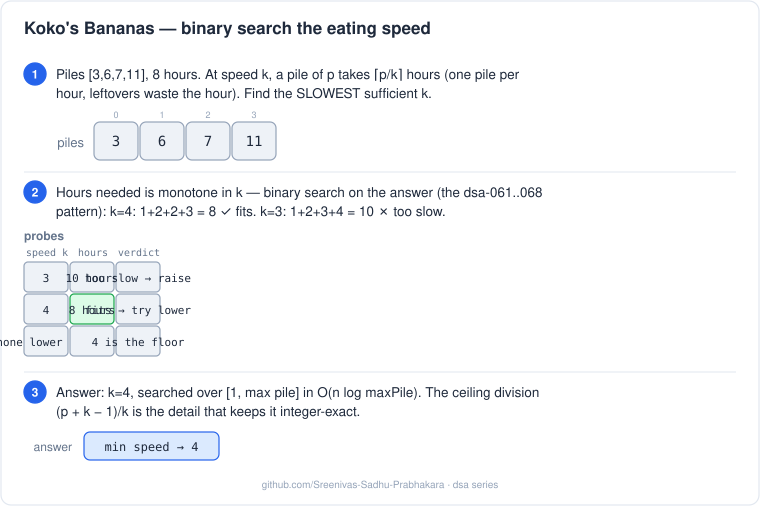

# Koko Eating Bananas

> NeetCode 150 · Binary Search — binary search on the eating speed; the feasibility check is a ceil-division sum, monotone in k. Go, stdlib only, tested.

## Problem

Piles of bananas, h hours, one pile per hour at a fixed speed k (a finished pile doesn't roll hours over). Find the minimum k that finishes in time.

## Approach

A direct member of the binary-search-on-the-answer family (Allocate Pages dsa-067, Aggressive Cows dsa-068): speed k is feasible iff `Σ ceil(pile/k) ≤ h`, and feasibility is monotone — faster never hurts — so binary search the smallest feasible k in [1, max pile]. The upper bound is max pile because exceeding it can't reduce any pile's hour count below 1. Integer ceil division via `(p + k − 1) / k` keeps everything in int. Guard-rails worth noticing: h ≥ number of piles is implied by the problem (one pile per hour), so the search space is never empty.

**Complexity:** O(n log max(pile)) time, O(1) space.

## Visual walkthrough

Read the picture top to bottom — each numbered frame is one moment of the algorithm
running on this repo's test example.

## Run

    go test ./...   # verify
    go run .        # demo

---

Part of a 275-repo DSA series in Go — Striver's SDE Sheet (dsa-001–191) plus the NeetCode 150 / Blind 75 additions (dsa-192–275), stdlib only, every solution tested. Browse: [`dsa-*` repos](https://github.com/Sreenivas-Sadhu-Prabhakara?tab=repositories&q=dsa-&type=source).
